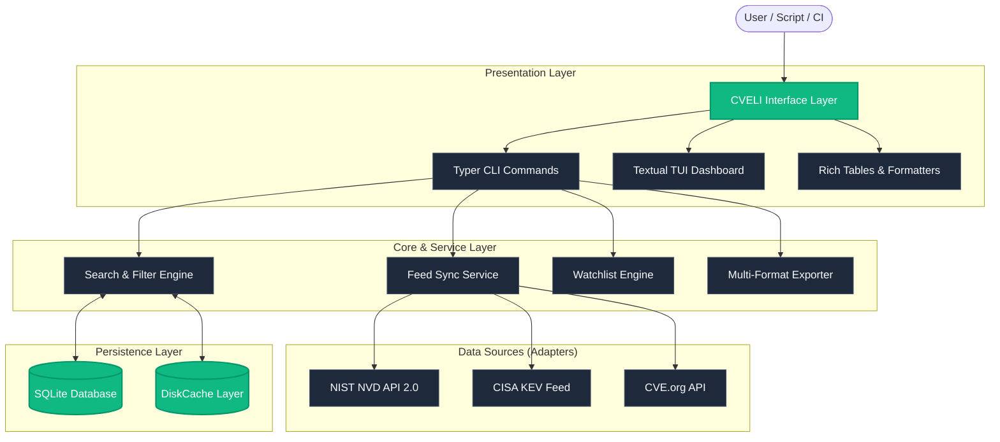

<div align="center">

```ascii
 ██████╗██╗   ██╗███████╗██╗     ██╗
██╔════╝██║   ██║██╔════╝██║     ██║
██║     ██║   ██║█████╗  ██║     ██║
██║     ╚██╗ ██╔╝██╔══╝  ██║     ██║
╚██████╗ ╚████╔╝ ███████╗███████╗██║
 ╚═════╝  ╚═══╝  ╚══════╝╚══════╝╚═╝
```

# 🛡️ CVELI — Search-First CVE & Vulnerability Intelligence CLI / TUI

**A modern, offline-first command-line terminal workspace and interactive TUI dashboard for searching, triaging, monitoring, and exporting Common Vulnerabilities and Exposures (CVEs).**

[](https://python.org)
[](https://opensource.org/licenses/MIT)
[](https://textual.textualize.io/)
[](https://typer.tiangolo.com/)
[](https://github.com/astral-sh/ruff)
[](https://mypy-lang.org/)

[Explore Features](#-key-features) • [Quickstart](#-quickstart) • [CLI Commands](#-command-reference) • [Interactive TUI](#-interactive-tui-dashboard) • [Architecture](#-architecture) • [Contributing](#-contributing)

</div>

---

## ⚡ Why CVELI?

Security analysts, DevOps engineers, and vulnerability researchers often waste valuable time jumping between sluggish web interfaces or parsing inconsistent raw feeds. 

**CVELI** brings vulnerability intelligence directly to your fingertips with sub-second terminal queries, offline SQLite caching, multi-source ingestion (NIST NVD + CISA KEV), watchlist tracking, and an interactive keyboard-first TUI dashboard.

> 🚀 **Built for Speed & Frictionless Triage:** Query vulnerabilities by vendor, CVSS score, EPSS probability, CISA KEV exploitation status, or publication timeframes in milliseconds.

---

## ✨ Key Features

| Capability | Highlights |
|---|---|
| 🔍 **Multi-Vector Search Engine** | Token matching, fuzzy search (rapidfuzz), CVSS/EPSS scoring filters, vendor/product queries, and CWE categorization. |
| 🌐 **Multi-Source Synchronization** | Ingest and normalize security feeds from **NIST NVD API 2.0**, **CISA KEV** (Known Exploited Vulnerabilities), and **CVE.org**. |
| 🖥️ **Interactive Textual TUI** | Fullscreen keyboard-driven terminal dashboard featuring live query updates, CVE inspectors, CVSS metric gauges, and quick filters. |
| 🎯 **Proactive Watchlist** | Track mission-critical components, software stacks, or CWE types with instant vulnerability alert scanning. |
| 📊 **Local SQLite & Disk Cache** | High-performance local SQLite storage with automated indexing and disk caching for fully offline or air-gapped workflows. |
| 📤 **Multi-Format Reporting** | Export security advisories and query results directly to **JSON**, **CSV**, **Markdown**, or plaintext reports. |
| 🛠️ **Unix-Friendly & Scriptable** | Clean piping capabilities with JSON outputs ready for tools like `jq`, custom automation, or CI/CD security pipelines. |

---

## 🎬 Terminal Preview

```
$ cveli search "OpenSSL" --min-cvss 7.5 --range 1y

┌────────────────┬──────────┬──────┬─────────┬───────────────────────────────┬────────────┐
│ CVE ID         │ Severity │ CVSS │ EPSS    │ Summary                       │ Published  │
├────────────────┼──────────┼──────┼─────────┼───────────────────────────────┼────────────┤
│ CVE-2024-0727  │ HIGH     │ 7.5  │ 0.0420  │ PKCS12 Decoding crash trigger │ 2024-01-25 │
│ CVE-2024-2511  │ HIGH     │ 7.5  │ 0.0381  │ Unbounded memory growth TLSv1 │ 2024-04-08 │
│ CVE-2024-4741  │ HIGH     │ 7.5  │ 0.0294  │ Use-After-Free in SSL_free    │ 2024-05-28 │
└────────────────┴──────────┴──────┴─────────┴───────────────────────────────┴────────────┘
Found 3 high/critical vulnerabilities matching criteria.
```

---

## 🚀 Quickstart

### Prerequisites
- **Python 3.12+**
- `git`

### Installation

```bash
# 1. Clone the repository
git clone https://github.com/jeevansai-k/cveli.git
cd cveli

# 2. Create and activate a virtual environment
python3 -m venv .venv
source .venv/bin/activate

# 3. Install in editable mode with development dependencies
pip install --upgrade pip
pip install -e ".[dev]"
```

Verify your installation:
```bash
cveli --help
```

---

## 📖 Command Reference

### 1. Search & Filter (`cveli search`)
Search through local and live feeds with rich colorized tables or interactive browsers.

```bash
# Search by keyword
cveli search openssl

# Filter by minimum CVSS score and severity
cveli search linux --min-cvss 8.5 --severity Critical

# Filter for vulnerabilities with confirmed in-the-wild exploits (CISA KEV)
cveli search microsoft --exploit-only

# Filter by specific vendor and CWE classification
cveli search --vendor apache --cwe CWE-79

# Filter by publication timeframe (1m, 3m, 6m, 1y, 2y, 5y, complete)
cveli search kubernetes --range 6m --limit 25

# Launch the interactive terminal detail browser
cveli search fortinet --interactive

# Output JSON directly to pipe into jq or CI pipelines
cveli search nginx --format json | jq '.[] | {id: .id, cvss: .cvss_score}'
```

---

### 2. Ingest & Sync Feeds (`cveli sync`)
Fetch, parse, and synchronize vulnerability feeds into the local SQLite database.

```bash
# Sync recent vulnerabilities matching a keyword
cveli sync --query openssl --limit 50

# Ingest high-priority feeds across sources (NVD API 2.0 & CISA KEV)
cveli sync --limit 100
```

---

### 3. Watchlist Monitoring (`cveli watchlist`)
Keep a proactive watch on your company's tech stack, third-party libraries, and software dependencies.

```bash
# Add monitored targets to your watchlist
cveli watchlist add --type vendor --value "OpenSSL" --notes "Core crypto library"
cveli watchlist add --type product --value "PostgreSQL" --notes "Production database"
cveli watchlist add --type cwe --value "CWE-89" --notes "SQL Injection patterns"

# List all tracked targets
cveli watchlist list

# Run a vulnerability alert check against active watchlist targets
cveli watchlist check

# Remove a target by ID
cveli watchlist remove --id <TARGET_ID>
```

---

### 4. Export Reports (`cveli export`)
Export filtered security records to share with DevOps, compliance, or incident response teams.

```bash
# Export to JSON
cveli export openssl --output reports/openssl.json --format json

# Export high/critical CVEs to CSV
cveli export --severity High --output reports/high_vulns.csv --format csv

# Export summary report to Markdown
cveli export linux --severity Critical --output reports/linux_critical.md --format markdown
```

---

### 5. Vulnerability Statistics (`cveli stats`)
View local database metrics, severity breakdown, and cached records telemetry:

```bash
cveli stats
```

---

## 🖥️ Interactive TUI Dashboard

Launch the full-screen terminal user interface with mouse & keyboard controls:

```bash
cveli tui
```
*(Or simply run `cveli` with no arguments)*

```
┌────────────────────────────────────────────────────────────────────────────┐
│ 🛡️  CVELI - Vulnerability Intelligence Dashboard                          │
├────────────────────────────────────────────────────────────────────────────┤
│ [Search: openssl__________________]  [Range: 1y ▼]  [Severity: All ▼]      │
├────────────────────────────────────────────────────────────────────────────┤
│ CVE ID         │ SEVERITY │ CVSS │ EPSS   │ SUMMARY                        │
│ CVE-2024-0727  │ HIGH     │ 7.5  │ 0.042  │ PKCS12 Decoding crash trigger  │
│ CVE-2024-2511  │ HIGH     │ 7.5  │ 0.038  │ Unbounded memory growth TLSv1  │
│ CVE-2024-4741  │ HIGH     │ 7.5  │ 0.029  │ Use-After-Free in SSL_free     │
├────────────────────────────────────────────────────────────────────────────┤
│ [Detail Inspector: CVE-2024-4741]                                          │
│ Impact: High CVSS 7.5 | Vector: CVSS:3.1/AV:N/AC:L/PR:N/UI:N/S:U/C:N/I:N/A:H│
│ Description: Specially crafted ASN.1 structures trigger heap corruption... │
└────────────────────────────────────────────────────────────────────────────┘
```

### Keyboard Shortcuts
| Key | Action |
|---|---|
| `q` / `Ctrl+C` | Exit TUI |
| `Tab` / `Shift+Tab` | Toggle focus between Search input and Results table |
| `Up` / `Down` | Navigate through CVE list |
| `Enter` | Open full CVE detail inspector panel |
| `Esc` | Close modal / return focus |

---

## ⚙️ Configuration & Environment

Configuration can be set via environment variables or a `.env` file in the project root:

```ini
# NIST NVD API Key (Recommended to increase rate limits from 5 to 50 req/30s)
NVD_API_KEY=your_nvd_api_key_here

# Optional: Custom storage & cache paths
CVELI_DB_PATH=storage/cveli.db
CVELI_CACHE_DIR=.cache/cveli
CVELI_LOG_LEVEL=INFO
```

---

## 🏗️ Architecture

CVELI is designed around clean domain layers and modular adapters:



### Directory Structure

```
cveli/
├── cli/                # Presentation Layer (Typer subcommands & Textual TUI)
│   ├── app.py          # Application entrypoint & CLI routing
│   ├── branding.py     # Terminal branding & ASCII artwork
│   ├── commands/       # CLI commands (search, sync, export, watchlist, stats)
│   └── tui/            # Textual TUI app, screens, and widgets
├── core/               # Domain Business Logic
│   ├── models.py       # Pydantic v2 data models (CVEModel, Severity, etc.)
│   ├── search.py       # Multi-field query execution & fuzzy matching
│   ├── filters.py      # Severity, CVSS, EPSS & range filters
│   └── formatter.py    # Rich terminal tables, panels & exporters
├── sources/            # Upstream Feed Adapters
│   ├── base.py         # Abstract Base Adapter interface
│   ├── nvd.py          # NIST NVD API 2.0 adapter
│   ├── cve_org.py      # CVE.org vulnerability feed adapter
│   ├── vendor.py       # CISA KEV & vendor feed adapters
│   └── epss.py         # EPSS score adapter
├── services/           # Application Service Orchestration
│   ├── sync.py         # Multi-feed ingestion & database synchronization
│   ├── export.py       # JSON/CSV/Markdown/Plaintext export service
│   ├── watchlist.py    # Monitored targets & proactive alerting
│   └── analytics.py   # Severity distribution & cache telemetry
├── storage/            # Persistence Layer
│   ├── database.py     # SQLite connection & SQLAlchemy 2.0 ORM session
│   ├── repositories.py # CVERepository Data Access Layer (DAL)
│   └── cache.py        # DiskCache query acceleration
├── docs/               # Architecture, API & Contributing documentation
└── tests/              # Comprehensive test suite (80+ unit & integration tests)
```

---

## 🧪 Testing & Quality Assurance

CVELI maintains high test coverage with automated unit, integration, and linting checks:

```bash
# Run pytest suite
pytest -v

# Run with test coverage report
pytest --cov=. --cov-report=term-missing

# Linting and formatting checks
ruff check .
ruff format --check .

# Static type checking
mypy cli core services sources storage utils
```

---

## 🤝 Contributing

Contributions, feedback, and feature requests are warmly welcomed!

1. **Fork** the repository
2. **Create** your feature branch (`git checkout -b feat/my-new-feature`)
3. **Commit** your changes (`git commit -m "feat: add support for custom feed"`)
4. **Push** to the branch (`git push origin feat/my-new-feature`)
5. **Open** a Pull Request

See [CONTRIBUTING.md](docs/contributing.md) for detailed guidelines.

---

## 📄 License

Distributed under the **MIT License**. See [`LICENSE`](LICENSE) for details.

---

<div align="center">

Crafted with 💚 by [**Jeevan Sai (@jeevansai-k)**](https://github.com/jeevansai-k)

</div>
