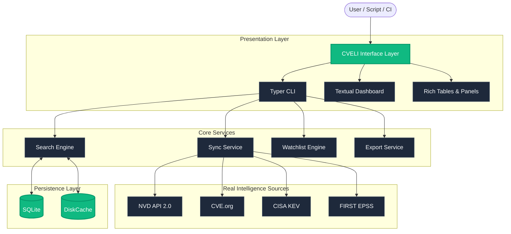

# CVELI

<div align="center">

```text
 ██████╗██╗   ██╗███████╗██╗     ██╗
██╔════╝██║   ██║██╔════╝██║     ██║
██║     ██║   ██║█████╗  ██║     ██║
██║     ╚██╗ ██╔╝██╔══╝  ██║     ██║
╚██████╗ ╚████╔╝ ███████╗███████╗██║
 ╚═════╝  ╚═══╝  ╚══════╝╚══════╝╚═╝
```

# 🛡️ CVELI — Search-First CVE & Vulnerability Intelligence CLI / TUI

**A modern, terminal-first platform for searching, triaging, monitoring and exporting real-time Common Vulnerabilities & Exposures (CVEs).**

*Created by **jeevansai-k***


**Real-time CVE Intelligence • Interactive TUI • Offline Cache • Multi-Source Search**

</div>

---

# ⚡ Why CVELI?

Security analysts constantly switch between **NVD**, **CVE.org**, **CISA KEV**, and **FIRST EPSS** to investigate vulnerabilities. CVELI unifies all of them into one fast, beautiful terminal application with intelligent caching, real-time searching, and an interactive Textual interface.

### Built For

* 🔐 Security Engineers
* 🛡️ SOC Analysts
* 🚨 Incident Responders
* ☁️ DevSecOps Teams
* 🎯 Vulnerability Researchers

---

# ✨ Key Features

| Capability                       | Description                                              |
| -------------------------------- | -------------------------------------------------------- |
| 🔍 **Real-Time Search**          | Search official CVE databases with intelligent filtering |
| ⚡ **Smart Cache**                | SQLite + DiskCache for extremely fast repeated searches  |
| 🖥️ **Interactive TUI**          | Keyboard-driven CVE browser with beautiful navigation    |
| 🌐 **Multi-Source Intelligence** | NVD, CVE.org, CISA KEV & FIRST EPSS                      |
| 📊 **Detailed CVE Inspector**    | CVSS, EPSS, KEV, CWE, Products & References              |
| 📤 **Multi-Format Export**       | JSON, CSV, Markdown & TXT                                |
| 🎯 **Watchlists**                | Track Vendors, Products & CWEs                           |
| 💾 **Offline-First**             | Previously fetched real CVEs remain searchable locally   |

---

# 🚀 Quick Start

## Requirements

* Python **3.12+**
* Git

## Installation

```bash
git clone https://github.com/jeevansai-k/cveli.git
cd cveli

python3 -m venv .venv
source .venv/bin/activate

python -m pip install --upgrade pip
python -m pip install -e ".[dev]"
```

Verify installation:

```bash
cveli --help
```

---

# 📖 Command Reference

## 🔍 Search CVEs

By default, searches only the **last 1 year** for maximum speed.

```bash
# Default (1 Year)
cveli search http

# Exact CVE
cveli search CVE-2025-32756

# Force live lookup
cveli search fortinet --live

# Cached search
cveli search nginx --cache

# Historical searches
cveli search openssl --range 3y
cveli search apache --range 5y

# Complete historical database
cveli search microsoft --range complete

# JSON output
cveli search CVE-2025-32756 --format json
```

### Search Options

| Option       | Description                                                      |
| ------------ | ---------------------------------------------------------------- |
| `--severity` | Critical, High, Medium, Low                                      |
| `--min-cvss` | Minimum CVSS score                                               |
| `--vendor`   | Vendor filter                                                    |
| `--cwe`      | Filter by CWE                                                    |
| `--exploits` | Show KEV/Public exploited records                                |
| `--limit`    | Maximum records                                                  |
| `--live`     | Force live API lookup                                            |
| `--cache`    | Use cached records only                                          |
| `--range`    | `1m`, `3m`, `6m`, `9m`, `1y`, `2y`, `3y`, `4y`, `5y`, `complete` |
| `--format`   | `table`, `json`, `markdown`, `detail`                            |

---

## 🔄 Synchronize Sources

```bash
# Synchronize all sources
cveli sync

# NVD only
cveli sync --source nvd

# CISA KEV only
cveli sync --source cisa_kev
```

---

## 📤 Export Reports

```bash
# JSON
cveli export openssl --format json --output reports/openssl.json

# CSV
cveli export fortinet --format csv --output reports/fortinet.csv

# Markdown
cveli export nginx --format markdown --output reports/nginx.md

# TXT
cveli export apache --format txt --output reports/apache.txt
```

---

## 🎯 Watchlist

```bash
# Add targets
cveli watchlist add --type vendor --value Fortinet
cveli watchlist add --type product --value OpenSSL
cveli watchlist add --type cwe --value CWE-79

# List
cveli watchlist list

# Check alerts
cveli watchlist check

# Remove
cveli watchlist remove Fortinet
```

---

## 📊 Statistics

```bash
cveli stats
```

Displays:

* Total CVEs
* Severity distribution
* KEV statistics
* Cache metrics
* Database information

---

# 🖥️ Interactive TUI Dashboard

Launch the dashboard:

```bash
cveli
```

### Terminal Preview

```text
┌─────────────────────────────────────────────────────────────────────────────┐
│ 🛡️ CVELI - Vulnerability Intelligence Dashboard                            │
├─────────────────────────────────────────────────────────────────────────────┤
│ Search: fortinet          Range: 1 Year          Severity: All             │
├─────────────────────────────────────────────────────────────────────────────┤
│ #  CVE ID            Severity   CVSS   EPSS   Published     Vendor         │
│ 1  CVE-2025-32756   HIGH       8.8    0.42   2025-05-14    Fortinet      │
│ 2  CVE-2025-31218   MEDIUM     6.4    0.11   2025-04-08    Fortinet      │
├─────────────────────────────────────────────────────────────────────────────┤
│ Alt+← Previous │ Alt+→ Next │ Enter Open │ Esc Back │ Q Main Menu         │
└─────────────────────────────────────────────────────────────────────────────┘
```

## Keyboard Shortcuts

| Key     | Action               |
| ------- | -------------------- |
| ↑ / ↓   | Navigate CVEs        |
| Enter   | Open highlighted CVE |
| Alt + → | Next page            |
| Alt + ← | Previous page        |
| Esc     | Return to CVE list   |
| Q       | Return to Main Menu  |
| Ctrl+C  | Exit CVELI           |

---

# 🌐 Real Data Sources

CVELI only displays **real vulnerability intelligence**.

| Source          | Data Used                              |
| --------------- | -------------------------------------- |
| **NVD API 2.0** | CVSS, CWE, Products, References, Dates |
| **CVE.org**     | Official CVE Records & Metadata        |
| **CISA KEV**    | Known Exploited Vulnerability Status   |
| **FIRST EPSS**  | Exploit Prediction Scoring System      |

> **Important:** Missing values are shown as **N/A**. CVELI never fabricates CVSS, EPSS, Vendors, Dates, Products or Summaries.

---

# ⚙️ Search Workflow

## Default Search Pipeline

```text
User Query
     │
     ▼
Last 1 Year Filter
     │
     ▼
Cache Lookup
     │
 ┌───┴──────────────┐
 │                  │
 │ Cache Hit        │ Cache Miss
 │                  │
 ▼                  ▼
Instant Results   Live Sources
                     │
                     ▼
            Normalize & Validate
                     │
                     ▼
              Store in Cache
                     │
                     ▼
               Render Results
```

---

# 🏗️ Interactive System Architecture



---

# 📂 Project Structure

```text
cveli/
├── cli/
│   ├── app.py
│   ├── branding.py
│   ├── commands/
│   └── tui/
├── core/
├── sources/
│   ├── nvd.py
│   ├── cve_org.py
│   ├── cisa_kev.py
│   └── epss.py
├── services/
├── storage/
├── docs/
└── tests/
```

## Folder Responsibilities

| Folder      | Responsibility                           |
| ----------- | ---------------------------------------- |
| `cli/`      | Typer commands & Textual UI              |
| `core/`     | Models, ranking, filtering & formatting  |
| `sources/`  | Official CVE source adapters             |
| `services/` | Sync, Export & Watchlist orchestration   |
| `storage/`  | SQLite repositories & cache layer        |
| `tests/`    | Unit, Integration & TUI regression tests |

---

# 📊 CVE Data Model

| Field             | Source        |
| ----------------- | ------------- |
| CVE ID            | NVD / CVE.org |
| Severity          | NVD           |
| CVSS Score        | NVD           |
| CVSS Vector       | NVD           |
| EPSS              | FIRST EPSS    |
| Vendor            | NVD           |
| Product           | NVD           |
| Affected Versions | NVD           |
| CWE               | NVD           |
| KEV Status        | CISA KEV      |
| Published         | NVD           |
| Modified          | NVD           |
| References        | NVD + CVE.org |

---

# ⚙️ Configuration

Create a `.env` file:

```env
NVD_API_KEY=your_api_key_here

CVELI_DB_PATH=storage/cveli.db
CVELI_CACHE_DIR=.cache/cveli
CVELI_LOG_LEVEL=INFO
```

---

# 🧪 Development

## Run Tests

```bash
.venv/bin/pytest
```

## Lint

```bash
.venv/bin/ruff check .
```

## Live Smoke Test

```bash
cveli search CVE-2025-32756 --live --format json
```

## Cached Smoke Test

```bash
cveli search CVE-2025-32756 --cache --format json
```

---

# 🤝 Contributing

```bash
# Create a feature branch
git checkout -b feat/my-feature

# Commit
git commit -m "feat: add new feature"

# Push
git push origin feat/my-feature
```

Open a Pull Request after pushing.

---

# 📜 License

**MIT License**

See the `LICENSE` file for details.

---

<div align="center">

## 💚 Crafted with Passion by Jeevan Sai

**GitHub:** `@jeevansai-k`

*Real-time Vulnerability Intelligence • Terminal Native • Open Source*

</div>
