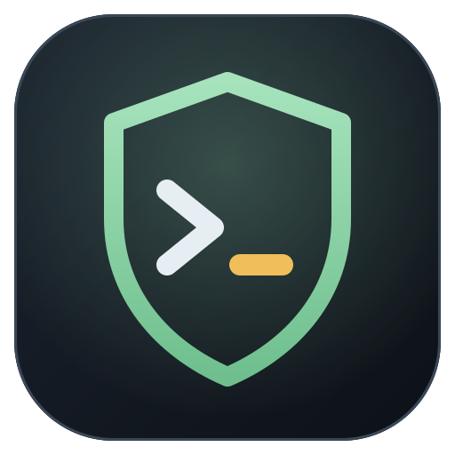
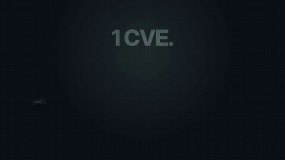
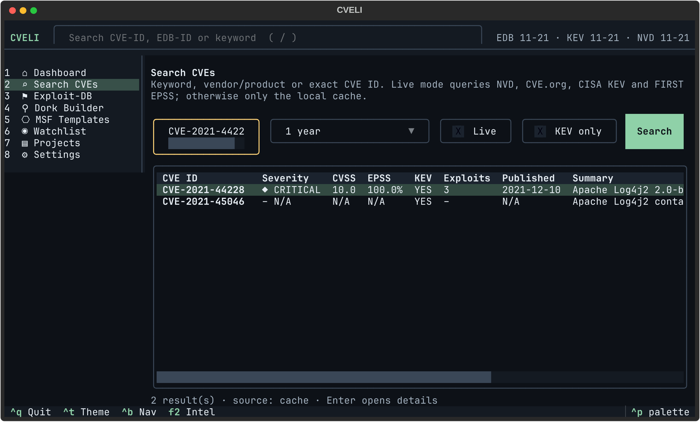
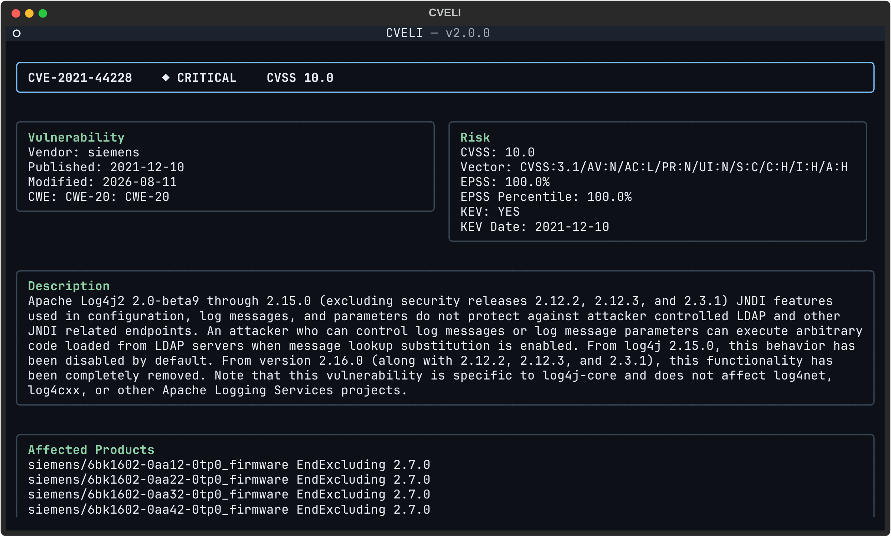
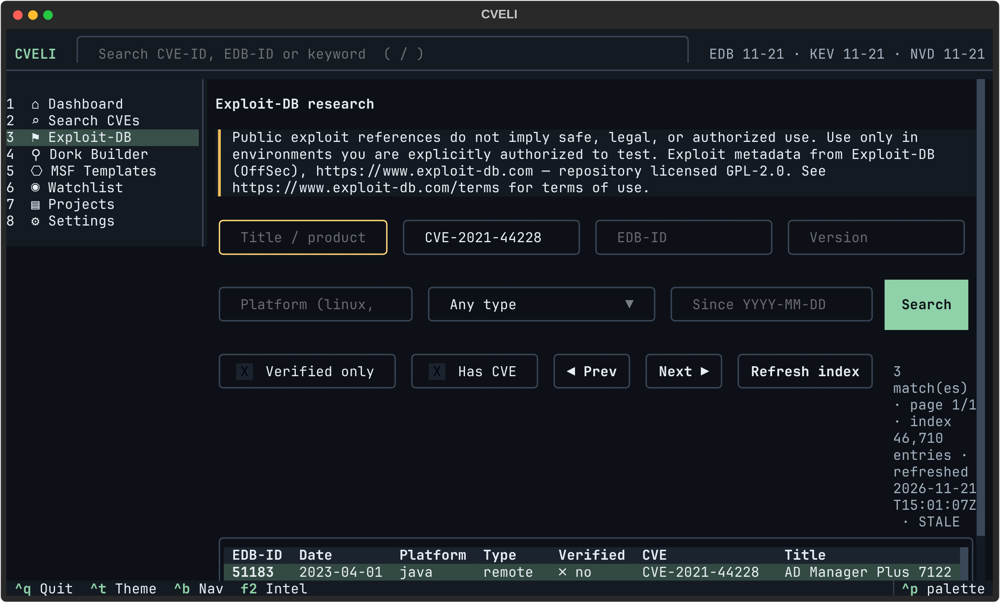
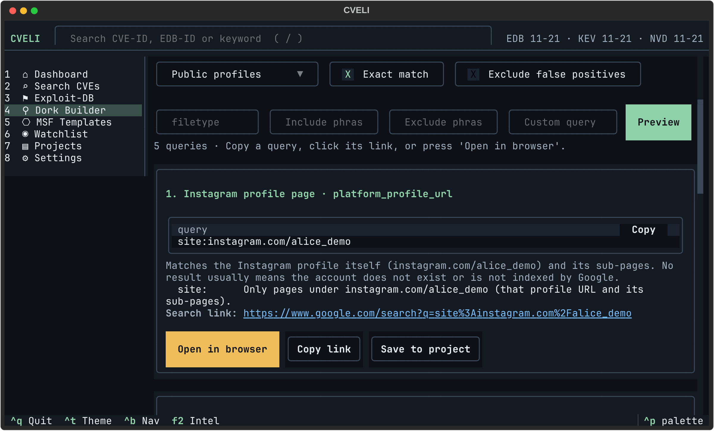
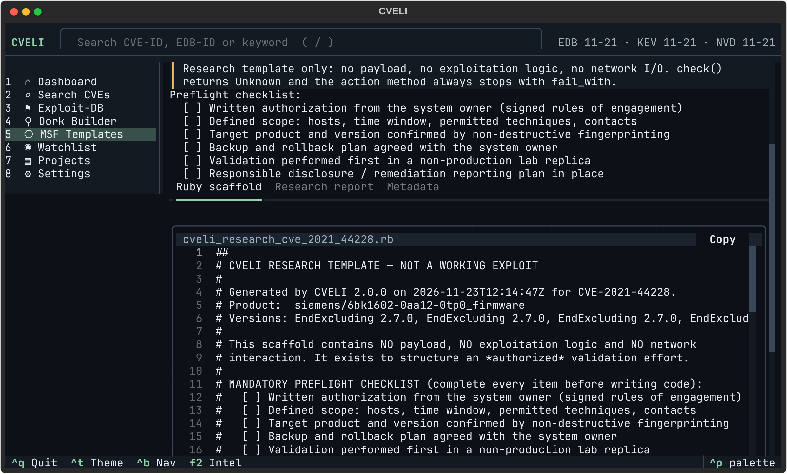
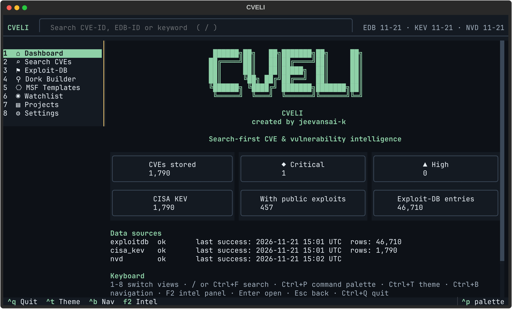
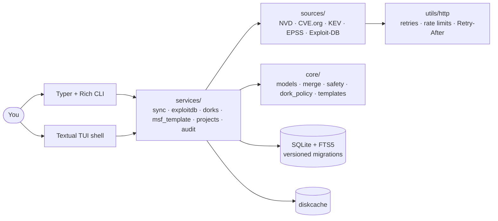

<div align="center">



# CVELI

### Every CVE signal. One terminal.

<sub>NVD · CVE.org · CISA KEV · FIRST EPSS · Exploit-DB, behind one search, keyboard-first, offline-ready and safe by design.</sub>

<br><br>

<a href="https://jeevansai-k.github.io/cveli/"></a>


<a href="https://github.com/jeevansai-k/cveli/actions/workflows/ci.yml"></a>

<br>

**[Website](https://jeevansai-k.github.io/cveli/)** ·
**[Quick start](#-60-second-quick-start)** ·
**[Commands](#-the-field-manual)** ·
**[Architecture](#-under-the-hood)** ·
**[Contributing](#-join-the-watch)** ·
**[Changelog](CHANGELOG.md)**

</div>

<br>

<div align="center">

<a href="site/assets/cveli-launch.mp4"></a>

<sub>▲ The 20-second launch film. Every frame is the real app. With sound:</sub>

<video src="https://github.com/jeevansai-k/cveli/raw/main/site/assets/cveli-launch.mp4" poster="https://github.com/jeevansai-k/cveli/raw/main/site/assets/cveli-launch-poster.jpg" controls muted playsinline width="860"></video>

</div>

---

## 🗂️ The five-tab problem

```text
 ┌─ NVD ──┐┌─ CVE.org ─┐┌─ CISA KEV ─┐┌─ FIRST EPSS ─┐┌─ Exploit-DB ─┐     ← you, every CVE, every day
 └────────┘└───────────┘└────────────┘└──────────────┘└──────────────┘
                                   │
                                   ▼
                     $ cveli search CVE-2021-44228
   CVE-2021-44228  ◆ CRITICAL  CVSS 10.0  EPSS 100.0%  KEV ✓  Exploit-DB 3 refs  Apache Log4j2…
```

Triage means opening the same five sources for every CVE: the score, the official
record, "is it exploited?", "will it be exploited?" and "is there public exploit
code?". **CVELI asks all five in one search**, merges the answers per CVE (a partial
KEV record never overwrites a richer NVD one), caches them locally and shows them in
a fast Textual TUI, or as JSON for your pipelines.

> [!IMPORTANT]
> **Authorized, defensive use only.** CVELI never exploits, scans or contacts the
> systems you research. It does not download exploit code, scrape Google or
> Exploit-DB, or build credential/secret-hunting queries. You are responsible for
> having written authorization for anything you test.

---

## ✨ What's inside

<table>
<tr>
<td width="50%" valign="top">

### ⌕ Live-first search
Keyword, vendor or exact CVE-ID across NVD, CVE.org, KEV and EPSS, with filters for
severity, CVSS, CWE, vendor, date range, KEV and public exploits.

</td>
<td width="50%" valign="top">

### ⚑ Exploit-DB intel
46,000+ entries indexed locally (FTS5): search by CVE, EDB-ID, fuzzy product,
version, platform, type, author and date. **Metadata only, never exploit code.**

</td>
</tr>
<tr>
<td valign="top">

### ⚲ Dork Builder
Username + site → previewed, explained Google queries, tuned for 22 social networks.
Secret-hunting patterns are **refused**, even in custom queries.

</td>
<td valign="top">

### ⎔ Research templates
A Metasploit `.rb` scaffold, a Markdown report and JSON metadata for any CVE or EDB
entry. `check` → `Unknown`; `exploit` → always `fail_with`. Zero payloads.

</td>
</tr>
<tr>
<td valign="top">

### ◉ Watchlists & projects
Track vendors, products and CWEs; see what's new since the last check; group CVEs,
exploits and dorks into research projects.

</td>
<td valign="top">

### ⛁ Offline & private
Local SQLite + cache, stale-but-served data when feeds go down, usernames redacted
from logs, no telemetry. `cveli privacy purge` wipes it all.

</td>
</tr>
</table>

### 🆕 What's new in 2.0

| Area | Highlights |
|---|---|
| Reliability | 17 bugs fixed with regression tests — incl. a data-loss bug where KEV/EPSS refreshes wiped stored CVSS scores, `.env` settings being ignored, `--range` not filtering cached results, missing NVD pagination/rate limiting |
| Exploit-DB | Local index of the official `files_exploits.csv` (46k+ entries): search by CVE, EDB-ID, product (fuzzy), vendor, version, platform, type, author, date; cross-linked into every CVE |
| Dork Builder | Username + site → previewed, explained, copyable Google queries; blocks secret/credential/dump patterns; opening in a browser needs an authorization confirmation and is rate-limited |
| MSF templates | `.rb` scaffold + Markdown research report + JSON metadata for a CVE/EDB entry; no payload or exploit logic; export requires a research-only confirmation |
| Design | New shell (navigation, command bar, intel panel, command palette), **Dark** (default) and **Light** themes, WCAG AA contrast tested, responsive down to 76 columns |
| Ops | XDG data paths, versioned DB migrations with automatic backup, `cveli doctor`, background jobs, local-only metrics, privacy purge |

See [CHANGELOG.md](CHANGELOG.md) for the full list and upgrade notes.

---

## 📸 Gallery

<table>
<tr>
<td><br><sub><b>Search</b>: one CVE, every signal</sub></td>
<td><br><sub><b>Detail</b>: products, Exploit-DB refs, sources</sub></td>
</tr>
<tr>
<td><br><sub><b>Exploit-DB</b>: 46k entries, filtered</sub></td>
<td><br><sub><b>Dork Builder</b>: explained, copyable queries</sub></td>
</tr>
<tr>
<td><br><sub><b>Templates</b>: preflight checklist first</sub></td>
<td><br><sub><b>Dashboard</b>: stats and source freshness</sub></td>
</tr>
</table>

---

## 🚀 60-second quick start

**Requirements:** Python 3.12+, a terminal with truecolor (most are), and optionally
a free [NVD API key](https://nvd.nist.gov/developers/request-an-api-key).

```bash
git clone https://github.com/jeevansai-k/cveli.git
cd cveli
python3 -m venv .venv
source .venv/bin/activate
python -m pip install -e ".[dev]"
```

```bash
cveli                         # open the TUI shell, then press /
cveli search CVE-2021-44228   # straight to Log4Shell
cveli doctor                  # check settings, paths and data sources
```

> [!TIP]
> Copy `.env.example` to `.env` and set `NVD_API_KEY` to raise the NVD rate limit
> from 5 to 50 requests per 30 seconds. The key is never logged.

---

## 📖 The field manual

<details open>
<summary><b>Search CVEs</b></summary>

```bash
cveli search openssl                     # last year, live + cache
cveli search CVE-2021-44228 --format detail
cveli search fortinet --range 5y --kev   # CISA KEV only
cveli search apache --public-exploit     # has Exploit-DB references
cveli search nginx --cache -f json       # offline, machine-readable
```

| Option | Description |
|---|---|
| `--severity` / `--min-cvss` / `--vendor` / `--cwe` | Filters (validated) |
| `--kev` · `--public-exploit` | CISA KEV listed · has Exploit-DB references (`--exploits` is a deprecated alias for `--kev`) |
| `--range` | `1m 3m 6m 9m 1y 2y 3y 4y 5y complete` — applies to live *and* cached results |
| `--live/--cache` | Query live sources first (default) or local data only |
| `--sort` | `published cvss epss updated id` |
| `--format` | `table` (TUI on a terminal, plain table otherwise), `json`, `markdown`, `detail`, `plain` |

</details>

<details>
<summary><b>Exploit-DB research (metadata only)</b></summary>

```bash
cveli exploits refresh                      # downloads files_exploits.csv if changed (24 h TTL)
cveli exploits refresh --from-path /usr/share/exploitdb   # offline / SearchSploit install
cveli exploits search --cve CVE-2021-44228
cveli exploits search --product "wordpress" --version 5.8 --type webapps --verified
cveli exploits search apache --platform linux --since 2023-01-01 --save linux-apache
cveli exploits search --load linux-apache -f json
cveli exploits show EDB-50592
cveli exploits status
```

Every result shows provenance (Exploit-DB link, original advisory), date, platform,
type, author, verified status and **safety labels** (`Research only`,
`Requires authorized environment`, `Proof-of-concept reference`, `Unverified`, …).

</details>

<details>
<summary><b>Google Dork Builder</b></summary>

```bash
cveli dork sites
cveli dork build --username alice --site github.com
cveli dork build -u @alice -s snapchat                      # platform names and @handles work
cveli dork build -u alice --category social                 # 22 social networks, no site needed
cveli dork build -u alice -s example.com --category documents --filetype pdf
cveli dork build -s example.com --category subdomains        # medium risk, warned
cveli dork open  -t public_profile_domain -u alice -s example.com   # asks for confirmation
cveli dork save  --project "Case 42" -u alice -s example.com
```

For social networks (Instagram, Snapchat, TikTok, X/Twitter, Facebook, Threads,
Reddit, YouTube, LinkedIn, Telegram, Bluesky, …) the username is often not in the
indexed page text, so CVELI builds platform-specific queries:

| Query | Example (Instagram, `@cristiano`) |
|---|---|
| Profile page (URL prefix) | `site:instagram.com/cristiano` |
| Profile by page title | `site:instagram.com intitle:"@cristiano"` |
| Mentions on the platform | `site:instagram.com "@cristiano"` |
| Sites linking to the profile | `"instagram.com/cristiano" -site:instagram.com` |

Display names ("Cristiano Ronaldo") are turned into a valid handle for the URL
queries while text queries keep the full name. Every result has a clickable
search link and a *Copy link* button; if no browser can be launched from your
terminal (SSH, WSL, VMs) the link is copied to the clipboard instead.

Categories: profiles, social media accounts, posts, documents, files, code, subdomains, login pages, public
directories, custom. Every operator is explained. Queries for passwords, tokens,
keys, config files, database dumps or breach data are **blocked**, including in
custom queries. CVELI never runs searches itself.

</details>

<details>
<summary><b>Metasploit research templates</b></summary>

```bash
cveli msf generate --cve CVE-2021-44228                 # preview .rb
cveli msf generate --edb 50592 --preview md             # preview the report
cveli msf generate --cve CVE-2021-44228 --out reports/  # export (asks for confirmation)
cveli msf history
```

The scaffold has the full metadata block, `check` returning `CheckCode::Unknown`,
an action method that always stops with `fail_with`, TODO markers and the
mandatory preflight checklist (authorization, scope, version confirmation,
backup/rollback, non-production validation, disclosure plan).

</details>

<details>
<summary><b>Everything else</b></summary>

```bash
cveli sync --source all            # nvd, cve_org, cisa_kev, epss
cveli export openssl -o report.csv -f csv
cveli watchlist add -t vendor -v Fortinet && cveli watchlist check
cveli project create "Case 42" && cveli project add "Case 42" cve CVE-2024-3400
cveli settings theme light         # dark | light | auto
cveli jobs run due                 # cron-friendly refresh of stale data
cveli privacy notice
cveli privacy purge
cveli stats
cveli cache status
```

</details>

### ⌨️ The TUI shell

```text
┌ CVELI ─ [ Search CVE-ID, EDB-ID or keyword ( / ) ] ─────────── EDB 11-21 · KEV 11-21 ┐
│ 1 ⌂ Dashboard     │ Search CVEs                                 │ Intel               │
│ 2 ⌕ Search CVEs   │ [openssl            ] [1 year ▾] ☑ Live     │ CVE-2024-3400       │
│ 3 ⚑ Exploit-DB    │ CVE ID          Severity    CVSS  EPSS  KEV │ Severity ◆ CRITICAL │
│ 4 ⚲ Dork Builder  │ CVE-2024-3400   ◆ CRITICAL  10.0  94.3% YES │ EPSS     94.3%      │
│ 5 ⎔ MSF Templates │ …                                           │ Exploit-DB 3 refs   │
│ 6 ◉ Watchlist     │                                             │                     │
│ 7 ▤ Projects      │                                             │                     │
│ 8 ⚙ Settings      │                                             │                     │
└ ^q Quit  ^t Theme  ^b Nav  f2 Intel ──────────────────────────────────── ^p palette ┘
```

| Key | Action |
|---|---|
| `1`–`8` | Switch view |
| `/` or `Ctrl+F` | Global search (CVE-ID, `EDB-…` or keyword) |
| `Ctrl+P` | Command palette (navigate, theme, refresh data, jump to CVE/EDB, **Keys** guide — select it again to close) |
| `Ctrl+T` | Toggle Dark / Light theme |
| `P` | Add the selected CVE / exploit / dork to an existing or new project |
| `Delete` | Remove the selected watchlist entry (or use **Remove selected**) |
| `Ctrl+B` / `F2` | Toggle navigation / intel panel |
| `Enter` / `Esc` | Open / back · `M` research template from a detail screen |
| `Alt+←/→` | Previous / next page in `cveli search` results |
| `Ctrl+Q` | Quit |

Accessibility: every colour pair meets WCAG 2.2 AA contrast (tested), focus is
always visible, severity is shown as symbol + word (never colour alone), motion can
be reduced (`cveli settings motion --reduce` or `CVELI_REDUCE_MOTION=1`), and every
feature has a plain CLI equivalent with `--format json` for screen readers and
scripts. `NO_COLOR` is honoured. A monospace font with good Unicode coverage
(JetBrains Mono, Fira Code, Cascadia Code) renders the icons best.

---

## 🛰️ Data sources

| Source | Used for | Access |
|---|---|---|
| NVD API 2.0 | CVSS, CWE, products, references, dates | rate-limited, paginated, optional API key |
| CVE.org | Official CVE records | exact CVE IDs |
| CISA KEV | Known exploited status + date | catalogue cached 24 h |
| FIRST EPSS | Exploit prediction score + percentile | batched ≤100 IDs |
| Exploit-DB | Public exploit **metadata** (`files_exploits.csv`, GPL-2.0) | conditional GET, 24 h TTL, or local checkout |

Missing values are shown as **N/A** — CVELI never fabricates scores, vendors, dates
or descriptions.

---

## ⚙️ Configuration

All settings come from the environment or a `.env` file (current directory or
`~/.config/cveli/.env`); see [.env.example](.env.example). Key variables:

| Variable | Default |
|---|---|
| `NVD_API_KEY` | unset |
| `CVELI_DATA_DIR` / `CVELI_DB_PATH` | `~/.local/share/cveli/cveli.db` |
| `CVELI_CACHE_DIR` | `~/.cache/cveli` |
| `EXPLOITDB_PATH` | unset (auto-detects `/usr/share/exploitdb`) |
| `CVELI_FEATURE_EXPLOITDB` / `_DORKS` / `_MSF` | `1` |
| `CVELI_THEME` | saved preference, else `auto` |

---

## 🧠 Under the hood



| Layer | Path | Responsibility |
|---|---|---|
| Interface | `cli/commands/`, `cli/tui/` | Typer commands, Textual shell, themes (`cli/tui/theme.py`, `cveli.tcss`) |
| Services | `services/` | Search & sync, Exploit-DB index, dork builder, template generator, projects, audit, jobs |
| Domain | `core/` | Pydantic models, field-level merge, safety labels, dork policy, template renderers |
| Sources | `sources/` | One adapter per feed (`fetch → parse → normalize`) on a shared HTTP client |
| Storage | `storage/` | SQLAlchemy 2.0 models, repositories, numbered migrations with automatic backup |
| Config | `config/` | Typed settings from env/`.env`, single version source |

Deep dives: [architecture](docs/architecture.md) · [API & JSON contracts](docs/api.md) ·
[operations](docs/operations.md) · [bug triage](docs/triage.md)

---

## 🛡️ Guardrails & privacy

| CVELI will… | CVELI will never… |
|---|---|
| Read public vulnerability feeds and Exploit-DB **metadata** | Contact, scan or exploit the systems you research |
| Link to Exploit-DB with attribution and safety labels | Download, store or display exploit code |
| Build explained dork queries you choose to open | Run Google searches itself, or build secret/credential/dump queries |
| Generate research scaffolds behind a confirmation | Emit payloads, request bodies or exploitation logic |
| Keep everything local and redact usernames from logs | Send telemetry anywhere |

Usernames, domains and dorks stay in memory unless you save them to a project. The
audit log records event types and identifiers only (90-day retention).
`cveli privacy purge` deletes all saved research data.

---

## 🧪 Development

```bash
make test        # pytest (~370 tests, network fully mocked)
make lint        # ruff
make typecheck   # mypy on the 2.0 modules
make cov         # coverage report
pytest -m live   # opt-in smoke tests against the real services
```

```text
cveli/
├── cli/          commands + Textual TUI (views, widgets, theme, cveli.tcss)
├── core/         models, merge, safety, dork policy, templates
├── services/     business logic
├── sources/      feed adapters
├── storage/      database, repositories, migrations
├── config/       settings + version
├── site/         the website (GitHub Pages) and launch video
├── docs/         architecture, API, operations, triage, contributing
└── tests/        pytest + Textual Pilot tests
```

CI (`.github/workflows/ci.yml`) runs ruff, mypy, pytest with coverage, pip-audit and
bandit on every push.

---

## 🤝 Join the watch

Bug reports, new data sources and new dork templates are all welcome.

1. Fork and branch: `git checkout -b feat/my-idea`
2. Write the regression test first, then the fix
3. `make lint test` must be green
4. Open a pull request describing the *why*

Read [docs/contributing.md](docs/contributing.md) first. New dork templates must
pass the safety policy, and nothing may contact a user-supplied target.

### 🗺️ Roadmap

- [x] Exploit-DB index and CVE cross-links
- [x] Guard-railed Dork Builder with social-media profiles
- [x] Non-weaponized research templates
- [x] Dark & Light themes, WCAG AA contrast
- [ ] OSV.dev and GitHub Security Advisories as sources
- [ ] SBOM import (CycloneDX / SPDX) → matching CVEs
- [ ] PyPI release (`pipx install cveli`)

---

## 📜 License

MIT, see [LICENSE](LICENSE). Exploit-DB metadata is © OffSec, GPL-2.0, and subject
to the [Exploit-DB terms](https://www.exploit-db.com/terms).

<div align="center">
<br>

<br>
<sub>Built by <a href="https://github.com/jeevansai-k">jeevansai-k</a>. Close the tabs. Open CVELI.</sub>
</div>
