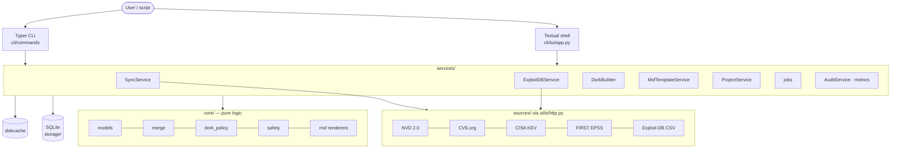

# CVELI 2.0 architecture

CVELI is a local, single-user terminal application: a Typer + Rich CLI and a
Textual TUI on top of shared services, a SQLite database and a disk cache. There is
no server and no account system; "authorization" means an explicit attestation by
the person running the tool, recorded in the local audit log.

## Packages

| Package | Responsibility | Key modules |
|---|---|---|
| `config/` | Typed settings from env/`.env`, version, defaults | `settings.py`, `version.py`, `defaults.py` |
| `core/` | Pure logic, no I/O | `models.py`, `merge.py`, `formatter.py`, `text.py`, `safety.py`, `dork_policy.py`, `dork_templates.py`, `msf/` |
| `sources/` | One adapter per upstream (`fetch` → `parse` → `normalize`) | `nvd.py`, `cve_org.py`, `vendor.py` (KEV), `epss.py`, `exploitdb.py` |
| `services/` | Orchestration, guardrails, auditing | `sync.py`, `exploitdb.py`, `dorks.py`, `msf_template.py`, `projects.py`, `jobs.py`, `audit.py`, `metrics.py`, `export.py`, `watchlist.py` |
| `storage/` | ORM models, migrations, repositories, cache | `database.py`, `migrations.py`, `repositories.py`, `exploit_repository.py`, `research_repositories.py`, `system_repositories.py`, `cache.py` |
| `cli/commands/` | One Typer module per command group | `search_cmd.py`, `exploits_cmd.py`, `dork_cmd.py`, `msf_cmd.py`, … |
| `cli/tui/` | Shell, views, widgets, theme | `app.py`, `views/*`, `widgets.py`, `theme.py`, `cveli.tcss`, `commands.py` |
| `utils/` | HTTP client, logging with redaction, errors, colour maths | `http.py`, `logger.py`, `errors.py`, `color.py` |

## Data model (SQLite, schema version 4)

| Table | Purpose |
|---|---|
| `cves` | Merged CVE records (CVSS, EPSS, `kev`, `public_exploit_count`, references, products, first-seen) |
| `exploits`, `exploit_cves`, `exploits_fts` | Exploit-DB metadata, CVE cross-reference, FTS5 index |
| `watchlists` | Vendor / product / CWE targets with last-check time |
| `projects`, `project_items`, `dork_saved` | Research workspaces — the only place user research inputs are stored |
| `generated_reports`, `saved_searches` | Template exports and saved queries |
| `user_settings` | Preferences (theme, motion, notice acknowledgements, open-rate timestamps) |
| `audit_log` | Event type + identifiers only (no free-text inputs), 90-day retention |
| `source_state` | Per-source last success/attempt, ETag, status, error, rows |
| `metrics` | Local counters/timings, 30-day retention |
| `schema_version` | Applied migrations |

Migrations live in `storage/migrations.py`; each is idempotent and a timestamped
backup is written before an existing database is upgraded.

## Merging and freshness

* `core/merge.py` merges partial records from several sources with precedence
  NVD > CVE.org > others; a field is only replaced by a present value from an
  equal-or-higher-ranked source, so partial KEV/EPSS rows never erase data.
* CISA KEV and Exploit-DB are refreshed at most once per TTL (`source_state`);
  failures keep the last good data and surface the error in `doctor`, the TUI status
  bar and JSON envelopes.
* `utils/http.py` applies timeouts, exponential backoff with jitter, `Retry-After`,
  and per-host token buckets (NVD 5/30 s, 50/30 s with a key).

## Guardrails

| Concern | Where |
|---|---|
| Feed text → terminal injection | `core/text.sanitize_terminal_text`, Rich `Text` (never markup) |
| Dork safety | `core/dork_policy.py` (input validation, normalised blocklist, risk levels) |
| Browser opens | `services/dorks.DorkBuilder.open` (attestation, persistent rate limit, audit) |
| Template safety | `core/msf/escape.py`, `services/msf_template.assert_safe`, export confirmation |
| Exploit-DB | metadata CSV only; `file_url` is a link that is never fetched |
| Privacy | `utils/logger` redaction; inputs persisted only via `ProjectService.save_dork` |
| Exports | `services/export.validate_output_path` (system dirs, symlinks, safe roots), CSV formula guard |

## Theme

`cli/tui/theme.py` is the single source of colour: two palettes (`opus-dark`,
`opus-light`) become Textual themes and a Rich theme for CLI output. `cveli.tcss`
uses only `$tokens`; tests enforce AA contrast and the absence of colour literals
elsewhere.
