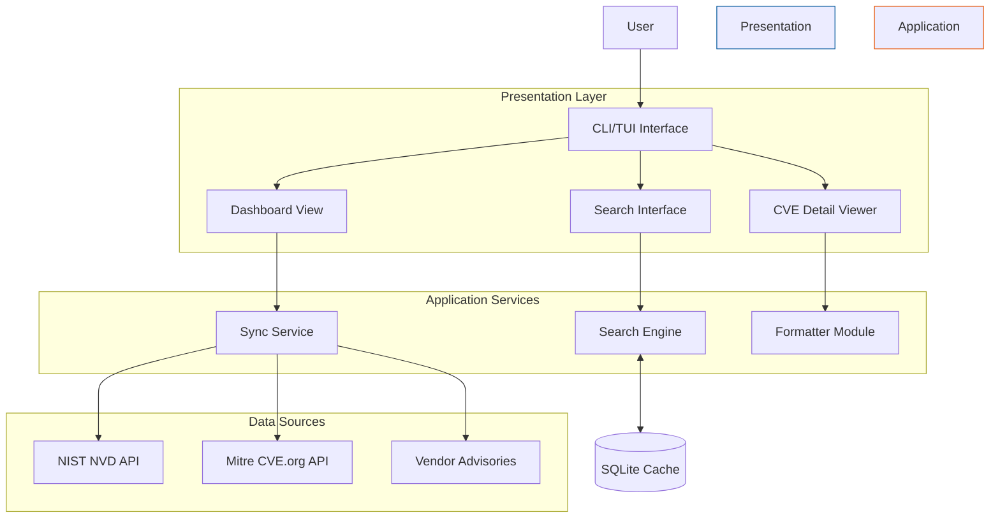

# CVELI Architecture

## Overview

**CVELI** is a high-performance CLI/TUI tool for searching, browsing, triaging, and managing Common Vulnerabilities and Exposures (CVE) data. It provides an extensible, modular architecture with clean separation of concerns.

## Project Structure

```
cveli/
├── cli/                   # Presentation layer (menus, TUI widgets)
│   ├── app.py             # Main CLI entry point using typer
│   ├── commands/          # Command-line subcommands (Typer)
│   └── tui/               # Textual terminal user interface
├── core/                  # Business logic layer
│   ├── models.py          # Data model definitions (Pydantic)
│   ├── search.py          # Search query processing and execution
│   ├── filters.py         # Filter criteria handling
│   ├── ranking.py         # Result sorting and ranking algorithms
│   └── validator.py       # Input validation utilities
├── sources/               # Data source adapters
│   ├── base.py            # Base adapter interface (ABC)
│   ├── nvd.py             # NIST NVD adapter implementation
│   ├── cve_org.py         # MITRE CVE.org API adapter
│   └── vendor.py          # Vendor advisory parser adapter
├── services/              # High-level orchestration
│   ├── sync.py            # Database synchronization
│   ├── export.py          # Multi-format export service
│   └── watchlist.py       # Watchlist management service
├── storage/               # Persistence layer
│   ├── database.py        # SQLite connection management
│   ├── repositories.py    # CRUD operations on data types
│   └── migrations.py      # Database schema migrations
├── config/                # Configuration settings
│   ├── settings.py        # Environment variable handling
│   ├── defaults.py        # Default configuration values
│   └── theme.py           # UI theming options
├── utils/                 # Reusable utilities
│   ├── logger.py          # Loguru logging configuration
│   ├── errors.py          # Custom exception classes
│   ├── helpers.py         # General-purpose utility functions
│   └── time.py            # Date/time formatting and calculations
├── assets/                # Static resources
│   ├── text/              # Textual CSS stylesheets
│   └── themes/            # Color schemes for different themes
├── tests/                 # Unit and integration test files
└── README.md             # Project documentation
```

## High-Level Architecture Diagram



## Module Responsibilities

### Core (Business Logic)

- **search.py**: Parses raw search queries and executes against indexed data using fuzzy matching
- **filters.py**: Implements filter criteria for severity levels, CVSS scores, date ranges
- **ranking.py**: Ranks results by EPSS score, exploit availability, or CVSS severity
- **validator.py**: Validates all user inputs to ensure data integrity

### Sources (Data Adapters)

Each adapter must implement three methods:
1. `fetch()` - Retrieves raw data from external source
2. `parse()` - Extracts CVE records from raw data
3. `normalize()` - Converts to canonical schema format

All sources return identical normalized output regardless of source-specific variations.

### Storage (Persistence)

- Handles SQLite database management with connection pooling
- Manages migrations for schema changes
- Implements disk-based caching for offline access

## Data Model

Every CVE record follows a standardized 14-field schema:

```json
{
  "id": "",              // Unique CVE identifier (e.g., CVE-2024-12345)
  "summary": "",         // Brief description of the vulnerability
  "severity": "",        // CVSS severity level (CRITICAL, HIGH, MEDIUM, LOW)
  "cvss_score": 0.0,     // Numeric CVSS score (0.0-10.0 or decimal)
  "vector": "",          // CVSS vector string representation
  "published": "YYYY-MM-DD",  // Publish date
  "updated": "YYYY-MM-DD",    // Update date
  "affected_products": [], // List of affected software products
  "references": [],        // External references/URLs to related info
  "exploit_available": false,     // Boolean indicating known exploits
  "epss": 0.0,             // Exploitation probability score (0-1)
  "cwe_id": "",            // CWE identifier if applicable
  "tags": []               // Tags for categorization
}
```

## Search Algorithm

The search system uses multiple matching strategies:

1. **Exact Matching**: First priority - exact CVE ID or summary matches get score of 1.0
2. **Fuzzy Matching**: Uses rapidfuzz library to find similar strings with configurable threshold (default 60%)
3. **Boolean Operators**: Support for AND, OR, NOT in queries
4. **Relevance Scoring**: Results ranked by match quality before filtering

Example query: `python AND vulnerable OR python` is parsed into multiple keywords with appropriate operators.

## Security Considerations

- All user inputs validated before processing (CVE IDs, dates, severity levels)
- SQL injection prevention via SQLAlchemy parameterized queries
- Path traversal protection in export operations
- Rate limiting prevents API abuse on external sources
- No secrets stored in code - all configuration from `.env` file

## Contributing Guidelines

1. Every module should document: Purpose, Inputs, Outputs, Responsibilities
2. Keep files under 300 lines where possible for readability by LLMs and humans
3. Use explicit naming over clever abbreviations
4. Maintain documentation in `docs/` directory
